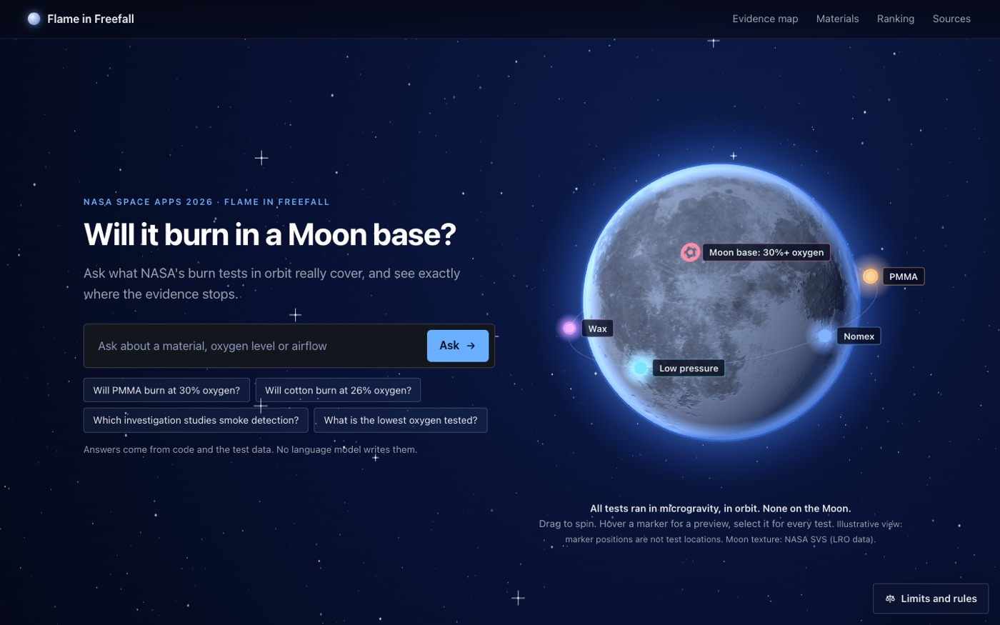
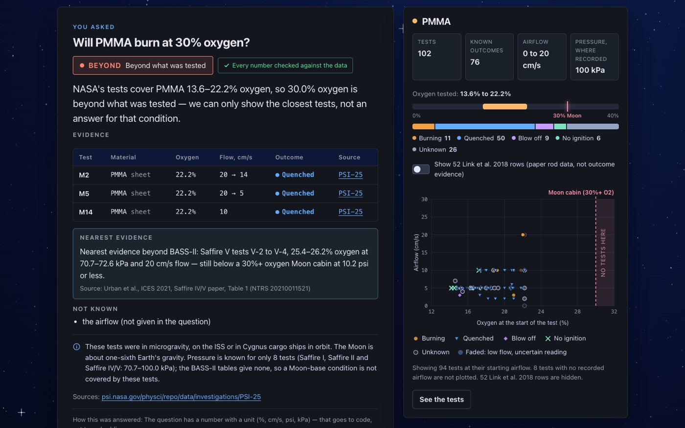
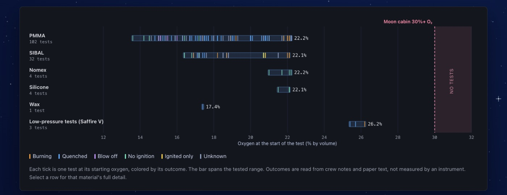

# Will it burn in a Moon base?

**Flame in Freefall**, NASA Space Apps Challenge 2026, Team **Lost in Andromedus**

A Moon base is expected to run at about **30% oxygen or more**. NASA's burn tests from space never went that high. This website shows exactly what has been tested, what happened, and where the evidence stops.



## What you can do on the site

- **Ask a question**, like "Will PMMA burn at 30% oxygen?" Every answer says whether the condition is **INSIDE**, **NEAR**, or **BEYOND** what NASA tested, shows the closest real tests, and says what is not known. Every number in an answer is checked against the data.
- **See the evidence on one chart.** Each row is a material. Each tick is one real test. The shaded band on the right is the 30% Moon base level, and it is empty.
- **Open a material card** (PMMA, SIBAL, Nomex, silicone, wax) to see how many tests there were, how they ended, and the oxygen and airflow range.
- **Rank NASA's experiments** by how useful each one is for fire safety in a crew habitat, with the reason for every point.
- **Spin the 3D Moon** and click a material marker to open its card. The Moon is just a way to navigate. All tests happened in orbit, none on the Moon.





**Main finding:** at normal cabin pressure, nothing was tested above 22.2% oxygen. The closest evidence is three Saffire V tests at 25.4 to 26.2% oxygen, run at low pressure.

## How to read an answer

Every answer starts with one of three verdicts. They compare your question to the conditions NASA actually tested for that material.

- **INSIDE:** the question falls within what was tested. Real tests exist at or around those conditions.
- **NEAR:** just outside the tested range, within 1.0 oxygen point or 25% of the material's airflow range. The tests are close but do not cover it exactly.
- **BEYOND:** outside everything tested for that material, so no test can say what would happen. It does not mean the material will or will not burn. It means the evidence stops before that point, so the answer shows the closest evidence instead of a guess. Example: PMMA at 30% oxygen is BEYOND, because the highest oxygen tested at normal cabin pressure is 22.2%.

Other labels: **MORE INFO** means the question had no oxygen level, so the site asks for one. **RESULT** means a plain fact from the table, such as "What is the lowest oxygen tested?". **Number check** means code confirmed every number in the answer is in the data.

Outcome words for each test: **quenched** (the flame went out on its own), **blow off** (the airflow pushed the flame off the fuel), **burning**, **no ignition** (the fuel never lit), **ignited only** (the notes say it lit but not how it ended), **unknown** (the notes do not say, so we do not guess).

## Run it on your computer

You need Python 3 (we used 3.12). In a terminal:

```bash
git clone https://github.com/dakshvk/lost-in-andromedus-flame-in-freefall.git
cd lost-in-andromedus-flame-in-freefall
pip install -r requirements.txt
python3 -m uvicorn api.app:app --port 8000
```

Then open **http://localhost:8000** in your browser.

To jump straight to an example answer, open
`http://localhost:8000/?ask=Will%20PMMA%20burn%20at%2030%25%20oxygen%3F`

Notes:

- The website's data is already included in `web/data/`. If you change anything in `data/` or `logic/`, rebuild it with `python3 web/export_data.py`, then restart the server.
- Restart the server after changing any Python file. It does not reload by itself.
- Optional: `pip install sentence-transformers` gives better matching for questions typed in plain words. It is a large download. Without it, the site still works and matches on key words. If you install it, the first start takes about 15 seconds while the search model loads.

## Getting the 3D Moon to show

The 3D Moon needs two things from your browser:

1. **WebGL turned on** (3D graphics in the browser).
2. **Internet access when the page opens.** The page loads a small 3D library (Three.js) from `cdn.jsdelivr.net`, and tries `unpkg.com` if the first one is blocked. The Moon picture itself is stored in this repo, so it needs no download.

If either is missing, the page shows a **flat Moon** instead, and the line under the Moon tells you why. Everything else on the site still works. To fix it:

- **Chrome:** open Settings, then System, and turn on "Use graphics acceleration when available". Restart Chrome. Then open `chrome://gpu` and check that the "WebGL" line says it is enabled.
- **Ad blockers and firewalls:** allow `cdn.jsdelivr.net` and `unpkg.com`, or pause the blocker for localhost.
- **Still flat?** Try another browser (Safari, Firefox, Edge) or the browser preview inside Cursor or VS Code. Open the browser's console (Cmd+Option+J in Chrome) and look for a message starting with "Moon:".
- **Want the Moon to hold still?** It turns slowly on its own, even when the Mac has "Reduce motion" on. Add `?spin=off` to the address to stop it. Dragging always works.
- To see the flat version on purpose, add `?moon=flat` to the address.

## Where the data comes from

All test data is public NASA data or from papers we cite. Each of the 200 rows in `data/tests.json` has its source written on it.

- **BASS-II** experiment on the International Space Station (ISS): 129 tests from NASA's [Physical Sciences Informatics](https://psi.nasa.gov) (PSI-25).
- **Saffire I, II and III** (PSI-98, 99, 100) and **Saffire IV and V** ([ICES 2021 paper](https://ntrs.nasa.gov/citations/20210011521)): large fires lit in a cargo spacecraft after it left the ISS.
- **Outcomes** (did it burn out, blow off, or never ignite) are not in the PSI table. We read them from the [BASS-II report](https://ntrs.nasa.gov/citations/20210011385) crew notes and the appendix of a [2015 NASA paper](https://ntrs.nasa.gov/citations/20150008962) (Zhao et al.). The page says where each one came from. If the notes do not say, we write "unknown" and do not guess.
- **Link et al. 2018** ([paper](https://doi.org/10.1038/s41598-017-18398-4)): 52 measurements kept on the side. They are not counted as test outcomes.
- **Moon picture:** NASA's Scientific Visualization Studio, [CGI Moon Kit](https://svs.gsfc.nasa.gov/4720) (made from Lunar Reconnaissance Orbiter data).

Words used: **PMMA** is a clear plastic used as a standard test fuel. **SIBAL** is a cotton and fiberglass fabric used in spacecraft fire tests. **Microgravity** is the near weightlessness inside the ISS.

## How we keep the answers honest

- A language model never writes an answer. Plain code decides INSIDE, NEAR or BEYOND, and a checker blocks any number that is not in the data.
- NEAR means within 1.0 oxygen point, or 25% of the airflow range, of what was tested. A material with fewer than 3 tests is called extrapolated.
- Tests flown at low pressure (Saffire V) are shown separately, never mixed into the normal ranges.
- The experiment ranking is our own judgment, not NASA's, and the page says so.

## What it cannot tell you

- Every test was in microgravity. The Moon has about one sixth of Earth's gravity, and NASA's PSI has no combustion data from partial gravity yet.
- Outcomes are labels read from notes, not instrument readings.
- Pressure is known for only 8 tests. The BASS-II tables do not give it.

The full list of rules and limits is in the "Limits and rules" panel on the site.

## What is in this repo

| Folder | What it holds |
|---|---|
| `data/` | The test table (`tests.json`), the source files in `data/raw/`, and checks. |
| `logic/` | The code that sorts INSIDE, NEAR and BEYOND, checks numbers, searches, and ranks. |
| `api/` | The small server that connects the logic to the website. |
| `web/` | The website. |
| `docs/` | Screenshots used in this file, and `docs/demo/` with the 7 slide demo deck (`lost-in-andromedus-demo.pptx`), its GIFs and the scripts that build it. |

`CHRONICLE.md` is a log of every change (who, what, why, how). `AI_USE_LOG.md` is a log of every use of AI.

## Check that it works

```bash
python3 -I data/scripts/validate.py          # data table check, should print OK
cd logic && python3 -m pytest -q             # 102 tests
cd .. && python3 -m pytest -q api            # 14 tests
```

## Use of AI

AI tools helped write code, data tooling, tests and documentation: Claude and Claude Code (Anthropic), Muse, and Cursor. The team chose the question and approach, and team members checked the results against the sources. Every file an AI helped write has a note in its header, and the full log is in `AI_USE_LOG.md`.

The default site has no AI-generated images. One optional comparison view (`?moon=illustration`) shows an AI-generated Moon image with a visible label.


## Team

Lost in Andromedus

| Name | What they worked on | Links |
|---|---|---|
| Daksh Kumar | Website | [GitHub](https://github.com/dakshvk) · [LinkedIn](https://www.linkedin.com/in/daksh-kumar-b60433345/) |
| Jenisha Subedi | Data | [GitHub](https://github.com/jenishasubedi05) · [LinkedIn](https://linkedin.com/in/jenisha-subedi9911) |
| Paridhi Jay Singh | Logic | [GitHub](https://github.com/paridhijsingh) · [LinkedIn](https://www.linkedin.com/in/paridhijsingh/) |

The demo video is linked on our NASA Space Apps project page.
